<p align="center">
  
</p>

<h1 align="center">NOOP Forge</h1>

<p align="center">
  <b>Your strap. Your numbers. Your coach.</b><br>
  A complete recovery, sleep and training app for your WHOOP strap.<br>
  One shared core, five apps: iPhone, iPad, Mac, Apple Watch and Android.<br>
  No subscription, no account, no cloud.
</p>

<p align="center">
  <a href="https://github.com/DX23876/noop/releases/tag/v12.2.1-dx"></a>
  <a href="https://github.com/DX23876/noop/releases/tag/testing-latest"></a>
  
  
  
  <a href="LICENSE"></a>
  <a href="https://discord.com/invite/wKgyqVdjrP"></a>
</p>

<p align="center">
  <a href="#what-is-noop-forge"><b>What is it?</b></a> ·
  <a href="#one-core-five-apps"><b>Platforms</b></a> ·
  <a href="#a-tour-of-the-app"><b>Tour</b></a> ·
  <a href="#noop-forge-on-android"><b>Android</b></a> ·
  <a href="#where-each-feature-runs"><b>Feature map</b></a> ·
  <a href="#install"><b>Install</b></a> ·
  <a href="#privacy-in-plain-words"><b>Privacy</b></a> ·
  <a href="#ideas-votes-and-taking-part"><b>Ideas and taking part</b></a> ·
  <a href="docs/README.md"><b>Docs</b></a>
</p>

<p align="center">
  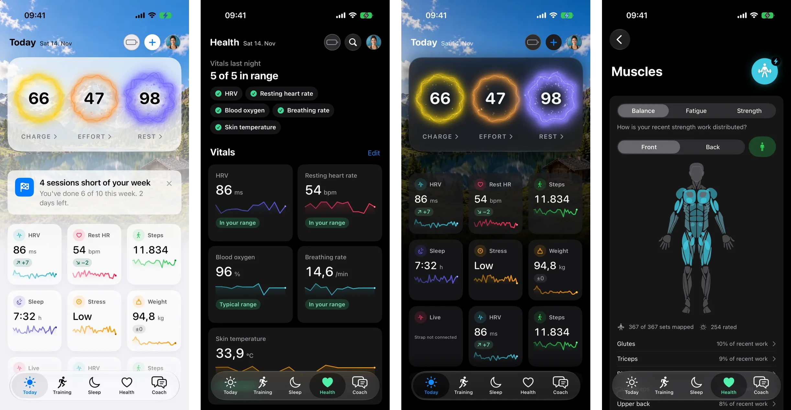
</p>
<p align="center"><sub>The 13.0 testing build in the app's built-in demo mode, with a made-up person and made-up numbers. The new design is still a switch in Settings › Lab ("New design"), off by default until it is finished.</sub></p>

---

## What is NOOP Forge?

A WHOOP strap measures your heart around the clock. Normally those measurements go to WHOOP's servers,
and you pay a monthly fee to see what they mean.

**NOOP Forge reads the strap directly over Bluetooth and works everything out on your own device.** How
well you recovered, how hard your day was, how you slept, how your training is going. Your data never
has to leave your phone, and there is nothing to subscribe to.

<table>
<tr>
<td width="33%" valign="top">

### 🔒 Yours, completely

No WHOOP account, no NOOP account, no servers. All your history lives in one file on your device.
Delete the app and the data goes with it. Move it to a new phone in one step.

</td>
<td width="33%" valign="top">

### 📏 Honest about every number

Each score tells you how it was made and where the data came from. When the app is not sure, it says
so instead of guessing.

</td>
<td width="33%" valign="top">

### 🏋️ More than a strap app

A full workout log, goals that adapt to real life, a body tracker, a food plan, an energy page and an
optional AI coach, all in one place.

</td>
</tr>
</table>

### What you need

- A **WHOOP 4.0, 5.0 or MG** strap. You do not need an active WHOOP membership.
- An **iPhone or iPad** with iOS 17 or later, a **Mac** with macOS 13 or later, or an **Android phone**
  with Android 8 or later.
- About five minutes to install it (see [Install](#install)).

### How it works in three steps

1. **Pair the strap.** NOOP Forge connects over Bluetooth and pulls in what the strap has stored.
2. **Let it learn you.** After a few nights it knows your normal heart rate, sleep and recovery. From
   then on every number is compared with *your* normal, not with an average person's.
3. **Open the app in the morning.** Three scores tell you how your body is doing and what kind of day
   it is ready for.

Already have years of data? Bring them along from a WHOOP export, Apple Health, Health Connect, Strong,
Hevy, FitNotes or Liftosaur, or from an Oura, Fitbit, Garmin or Mi Fitness export.

---

## One core, five apps

Every number in NOOP Forge is worked out by the **same shared Swift core**. The apps on top of it are
thin: they draw screens, talk to Bluetooth and ask the core for the answers. Android does the same
through a bridge, and stores its data in the same database the iPhone uses.

That is the whole point of the design: **the same night gives the same Charge on an iPhone, a Mac and an
Android phone.** No second implementation that can drift, no two sets of numbers to explain.

<p align="center">
  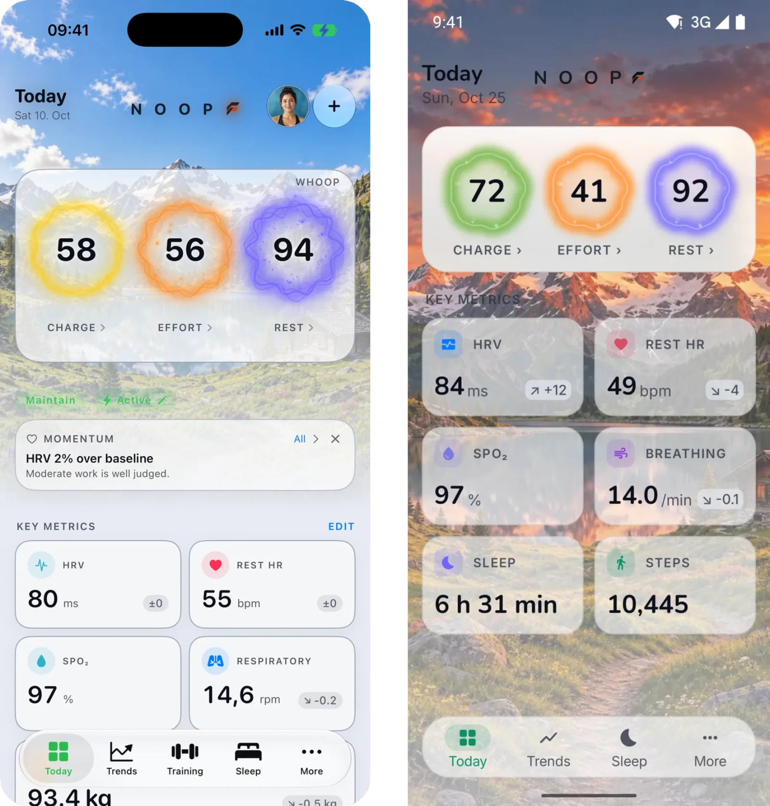
</p>
<p align="center"><sub>Left: iPhone. Right: Android. The same core, the same screens. Two different demo days, so the numbers differ.</sub></p>

<table>
<tr>
<td width="50%" valign="top">

### 📱 iPhone and iPad

**iOS 17 or later. The full app.** Everything in this README runs here: scores, sleep, training with
GPS, muscle analysis, goals, body, food, ECG on a WHOOP MG and the coach. Home Screen and Lock Screen
widgets, Live Activities in the Dynamic Island, Siri and Shortcuts.

New features are built here first.

</td>
<td width="50%" valign="top">

### 💻 Mac

**macOS 13 or later. The app on a big screen.** Scores, sleep, training, goals, body, energy, ECG and
the coach in a sidebar layout, plus your live heart rate in the menu bar. It pairs with the strap
itself over Bluetooth, so a Mac can be your only device. The phone-shaped screens, the food log and
cycle tracking stay on the phone.

</td>
</tr>
<tr>
<td width="50%" valign="top">

### ⌚ Apple Watch

**watchOS 10 or later.** A companion app with complications on the watch face, live heart rate, the
breathing exercise, workouts and your goals. The iPhone stays the brain; the watch is the quick way in
and a second heart-rate source for workouts.

</td>
<td width="50%" valign="top">

### 🤖 Android

**Android 8 or later. A testing build.** Android runs the same shared Swift core, stores in the same
database and shows the same screens. What is still open is the part no emulator can prove: Bluetooth
behaviour on real phones. See [NOOP Forge on Android](#noop-forge-on-android).

</td>
</tr>
</table>

> [!NOTE]
> **How Android ended up on the Swift core.** The original project keeps a separate Kotlin
> reimplementation and a rule that both must produce byte-identical numbers. This fork dropped that rule
> in July 2026, brought Android back on the shared core in October 2026 and removed its own Room
> database in November 2026. Kotlin now owns Bluetooth, Android services and the screens; everything
> that computes a number lives in the core. Details: [`docs/CROSS_PLATFORM.md`](docs/CROSS_PLATFORM.md)
> and [`docs/fork/android/CORE-ONLY-PLAN.md`](docs/fork/android/CORE-ONLY-PLAN.md).

### What is in the current builds

<table>
<tr>
<td width="50%" valign="top">

#### ✅ Released: 12.2.1

- Elevation and grade on GPS workouts
- Start a recent activity in one tap
- Settings sorted by task
- A faster gym logger with last session's set beside every row
- The next set and its rest timer on the Lock Screen
- Routines imported from Hevy or an OpenGym plan

iPhone, iPad, Mac and Apple Watch. Release notes:
[12.1.0](docs/fork/releases/v12.1.0.md) ·
[12.2.0](docs/fork/releases/v12.2.0.md) ·
[12.2.1](docs/fork/releases/v12.2.1.md)

</td>
<td width="50%" valign="top">

#### 🧪 In testing: 13.0

- A redesigned app, the one in the pictures here, behind a switch in Settings › Lab until it is finished
- Effort recalibrated on 3,760 real workouts
- Your own maximum heart rate, learned from your workouts
- Your whole history scored again once, by the same method
- A food log with barcode scanning and a diet plan
- **Android, Mac and iPhone on one shared core**

iPhone, Mac and Android.
[What to test](docs/fork/TESTING-13.0.0.md) ·
[draft release notes](docs/fork/releases/v13.0.0.md)

</td>
</tr>
</table>

---

## A tour of the app

Five places, and everything else hangs off them: **Today**, **Training**, **Sleep**, **Health** and
your **Coach**.

### Today: your day at a glance

<p align="center">
  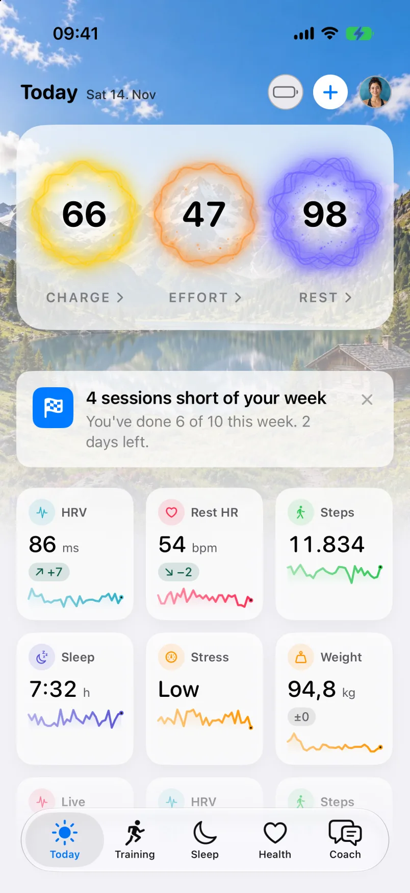
  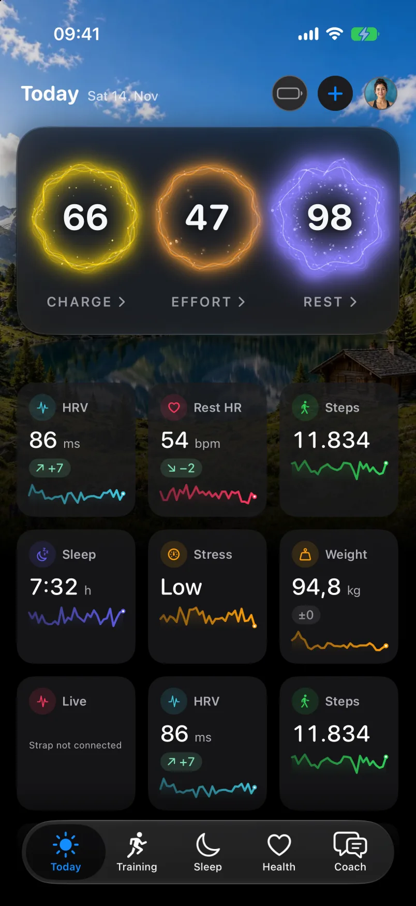
  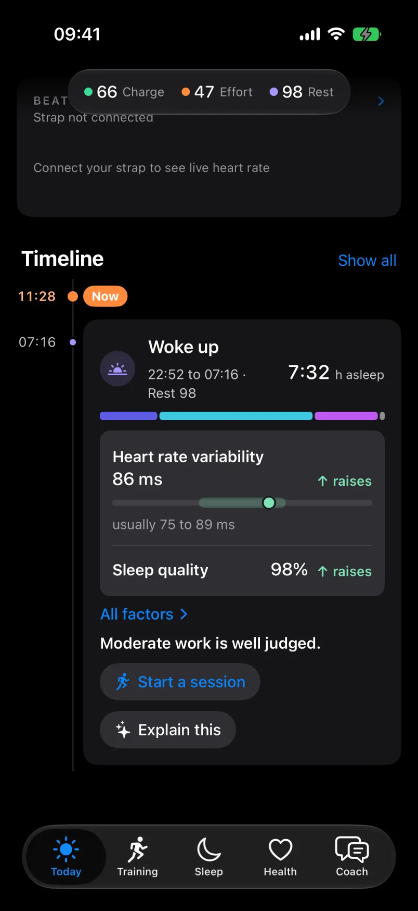
</p>

Three rings show your **Charge** (how recovered you are), your **Effort** (how much strain your day has
had so far) and your **Rest** (how well you slept). Behind them sits a picture that changes with the
time of day.

**The rings are alive.** Each one is a glowing band of fine threads that moves slowly, as if it were
breathing. The higher your score, the more little sparks fill the circle. Effort glows brighter and
breathes deeper once your day gets moderately hard. When the app opens, the numbers count up from zero
once. All of this stops when you turn on Reduce Motion, use Low Power Mode or switch the motion off in
the app, and plain rings take over.

Below the rings is **your own dashboard**. Every tile is one you placed: heart rate variability,
resting heart rate, steps, sleep, stress, weight, live heart rate, energy, a goal, your fitness age.
Hold a tile to move it, resize it or swap it for another. Each one carries a small line of your recent
days and a badge against your own normal, so "±0" means a typical day and "↘ −2" a real change.

Further down, the **timeline** tells the day as it happened: when you woke, what the night was worth,
what raises or lowers your Charge today, what the app suggests you do with it, and your workouts and
live heart rate as they come in.

### The three scores, explained

<table>
<tr>
<td width="36%" align="center">
  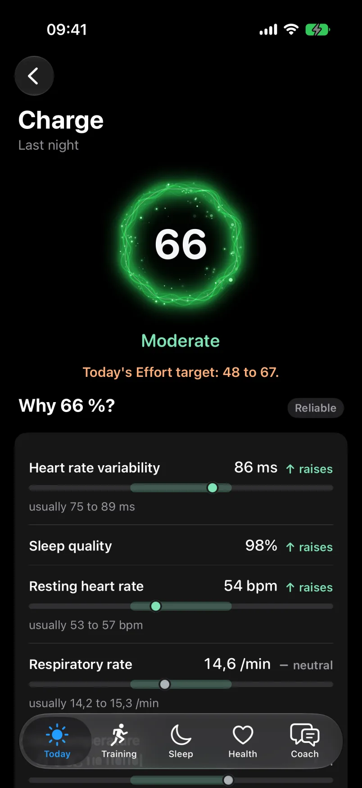
</td>
<td width="64%" valign="middle">

**Charge (0 to 100): how ready is your body?**
Measured every morning from your night. The biggest part is your heart rate variability (HRV), the
small differences between heartbeats. A rested body shows more variation. Resting heart rate, sleep
quality, breathing rate and skin temperature make up the rest.

**Tap the ring and the app shows its work.** "Why 66 %?" lists every factor with your value, your own
usual range for it, and whether it raised or lowered the score. A badge says how reliable the reading
is, and the page names the Effort target that fits today's Charge.

**Effort (0 to 100): how hard was your day?**
Grows through the day as your heart works above its resting level. A hard workout fills it quickly, a
walk slowly. It is scaled to you, so a hard day reads as hard *for you*. In 13.0 it follows one curve
fitted on 3,760 real workouts and uses the maximum heart rate you actually reach (a value you enter in
Settings always wins).

**Rest (0 to 100): how good was your sleep?**
Compares the sleep you got with the sleep you needed, and looks at how deep and how steady it was.

</td>
</tr>
<tr>
<td width="64%" valign="middle">

**No black box.** A "How scoring works" page lists the exact weighting: heart rate variability about
55%, resting heart rate about 20%, sleep quality about 15%, breathing and skin temperature about 5%
each.

These scores are NOOP's own estimates built on published research. They are **not** WHOOP's scores and
will not match them exactly. In return you can see how every one of them is made.

</td>
<td width="36%" align="center">
  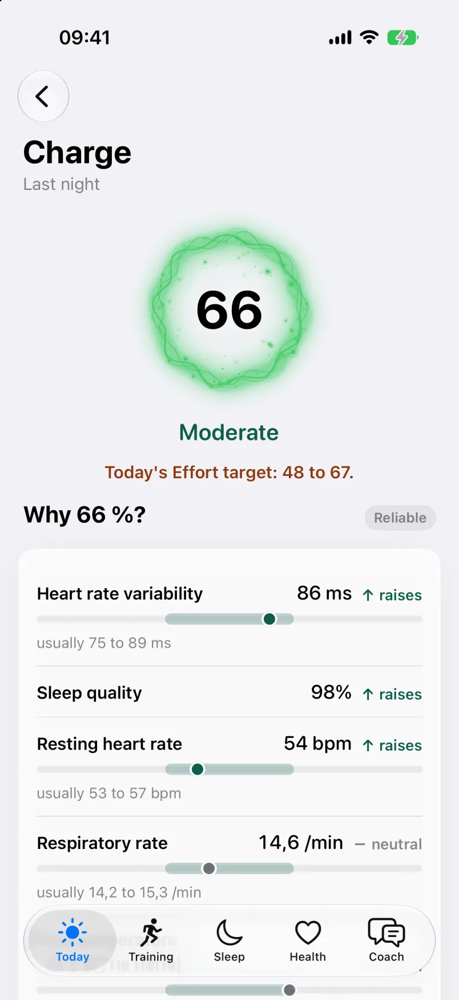
</td>
</tr>
</table>

### Sleep: what your night really was

<table>
<tr>
<td width="36%" align="center">
  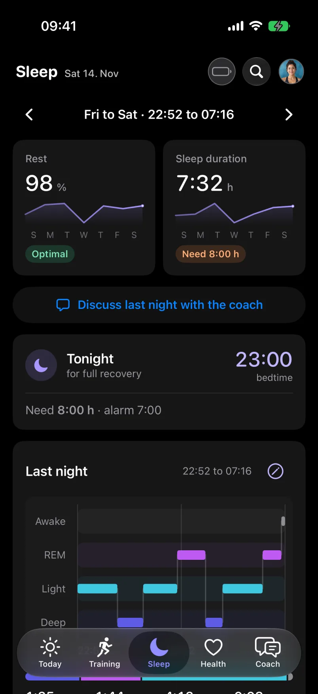
</td>
<td width="64%" valign="middle">

Every morning you see your sleep score, when you fell asleep and woke up, and how the night split into
**deep sleep, REM and light sleep**, drawn as it actually ran. Each stage is compared with your typical
night, so you can see at a glance whether you got less deep sleep than usual.

- **Tonight** names the bedtime that would give you full recovery, with the sleep you need and the
  alarm you have set.
- **Sleep debt** tracks how much sleep you are short, and it shrinks again when you catch up.
- **Flip back** to any earlier night, and correct one the strap got wrong.
- **Strap alarms** wake you with a silent buzz on the wrist, and an evening reminder tells you when to
  wind down.
- If the strap only recorded part of the night, the app says so instead of showing a misleading score.

</td>
</tr>
</table>

### Health: your body, in one place

<p align="center">
  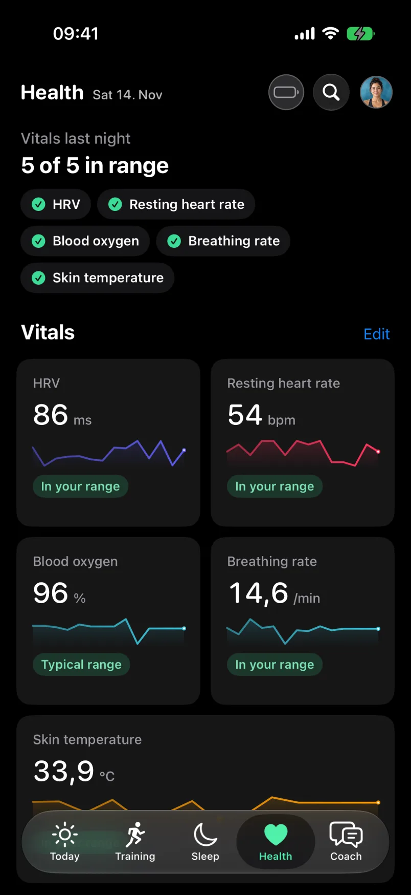
  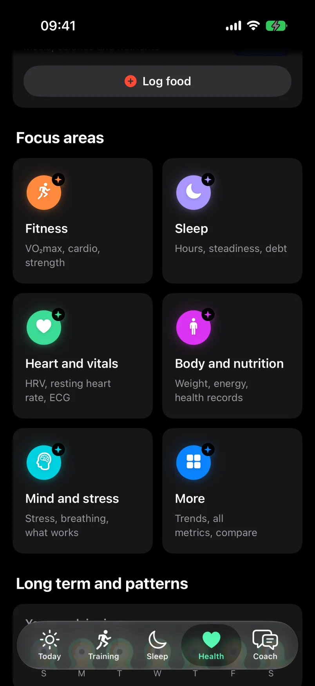
  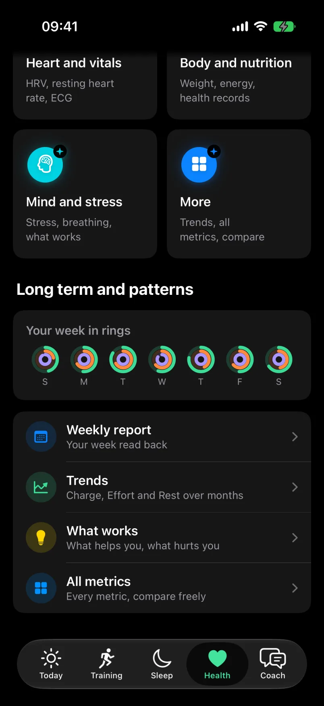
</p>

The **Health** tab opens with last night's vitals and says plainly how many of them are in your own
range. Under that, the app is sorted into **focus areas** rather than a long list:

| Area | What is in it |
|---|---|
| **Fitness** | VO₂max, cardio, strength, training load, workouts |
| **Sleep** | Hours, steadiness, debt |
| **Heart and vitals** | HRV, resting heart rate, blood oxygen, breathing, skin temperature, ECG |
| **Body and nutrition** | Weight, body, energy, water, health records |
| **Mind and stress** | Stress, breathing, what works for you |
| **More** | Trends, every metric, compare freely |

**Long term and patterns** sits at the bottom: your week drawn as seven small ring sets, a weekly
report that reads your week back to you, trends over months, and "What works", which checks which of
your own habits really move your scores and says so in plain words, or says there is no clear effect
yet.

**Stress** shows how strained your nervous system is during the day, on a simple scale from calm to
high. It compares your heart rate and HRV with your own normal, not with other people. Hours when you
were simply moving are marked as such, and "calm time" tells you how much of your recent days were
relaxed.

### Training: plan it, start it, log it

<table>
<tr>
<td width="36%" align="center">
  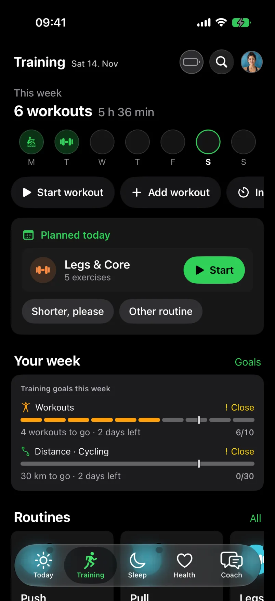
</td>
<td width="64%" valign="middle">

The **Training** tab is your gym notebook. Your week sits at the top: how many sessions, how long, and
which days you have already trained. Under it, what is planned for today, with **Start** right there,
and two quick ways to change your mind ("Shorter, please", "Other routine").

**Starting a workout always opens the same screen**, wherever you tap it: today's plan, a freestyle
session, one of your routines, or a cardio activity like running or cycling.

During a strength workout you see each exercise with **what you lifted last time** and a hint for today
("stalled, load goes down to rebuild"). Weight and reps go in on a number pad, last session's set sits
beside each row and a tap copies it. Tick off a set and the rest timer starts on its own; the **Lock
Screen** shows the next set, counts down your rest and logs the set with one tap. Everything works
offline, even in a basement gym without signal.

Extras for those who want them: supersets, one-arm and one-leg exercises, how hard a set felt, warm-up
sets, a plate calculator and 1,324 exercises with descriptions.

</td>
</tr>
</table>

### Running, walking and cycling with GPS

Pick an activity, decide whether to record the route and press **Start**. Outdoor activities such as
running, walking, hiking, cycling, rowing or open-water swimming can record a GPS route. Indoor ones
like a treadmill run never ask for your location. Your heart rate comes from the strap or an Apple
Watch.

**While you run** the screen shows the time in large numbers, then heart rate, Effort, distance, your
current pace and your average pace. The iPhone's barometer counts your climbs, so you also get an
elevation profile, the grade and a grade-adjusted pace. Swipe to two more pages: the **heart rate
zones** you have spent time in, and your **laps and kilometre splits**. The workout keeps running with
the phone in your pocket and shows on the Lock Screen and in the Dynamic Island.

| Setting | What it does |
|---|---|
| **Voice feedback** | Spoken updates every 0.5, 1 or 2 km (or miles), or every 5, 10 or 15 minutes, with your split pace and heart rate. Works offline, in the app's language, through headphones by default. Music is turned down only while it speaks |
| **Target-zone warnings** | Pick a heart-rate zone before you start. The phone tells you when you stay outside it, and with a strap a gentle buzz says "faster" or "slower" |
| **Pace or speed warnings** | A target pace for running or a speed for cycling. Warnings come only after ten seconds outside your range and at most once a minute |
| **Auto-pause** | For GPS running and cycling. Pauses after five seconds standing still, for example at a traffic light, and continues after three seconds of moving |
| **Training plan** | Build intervals: warm-up, work, recovery and cool-down, each by time or distance. Save them as templates and change upcoming steps during the run |
| **Pacer** | Set a goal time for a distance and see whether you are ahead or behind |
| **Speaker** | Off by default, so nothing is read out loud on the bus by accident |

**Honest GPS.** The app only counts distance when the phone is sure you are really moving. Weak or
jumpy GPS points are thrown away, and a gap in the signal is shown as a gap instead of a straight line
across the map. With poor reception it may record a little too little, never too much.

**Afterwards** you get a summary with your route, splits and zones. If you ran your fastest kilometre
so far, it tells you. The workout can go to Apple Health with its route, and you can export it as a GPX
or FIT file for other apps.

### Strength: what you lifted, and which muscles did the work

<p align="center">
  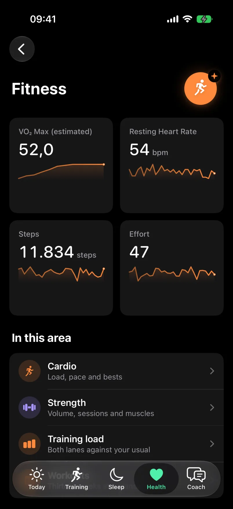
  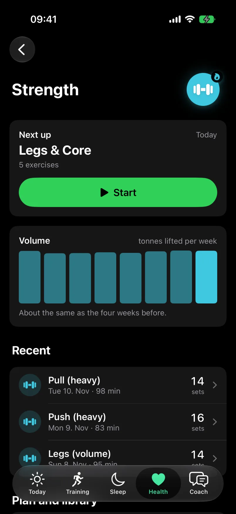
  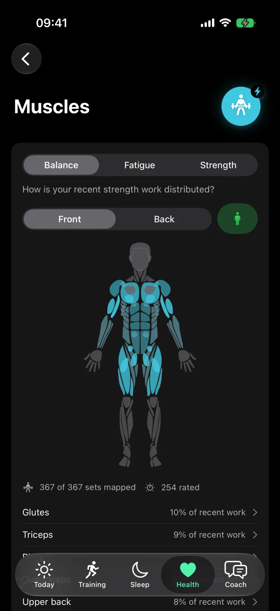
</p>

**Strength** shows what is planned, how much you have lifted week by week and which sessions those were.

The **muscle map** answers three plain questions on one body:

- **Balance:** which muscles got how much work recently, compared with what is normal *for you*. No
  ideal physique, no universal rules.
- **Fatigue:** which muscles probably still carry training stress from recent sessions.
- **Strength:** for which muscles your lifts are going up, staying level or going down.

A set that was close to failure counts more than an easy one, and the page says how many of your sets
it could map at all. If it cannot tell which muscle an exercise trains, it says so instead of guessing.
Details: [muscle analytics](docs/fork/MUSCLE_ANALYTICS.md).

**Training Load** compares your last seven days with your own history and says in one sentence what it
means: building up, holding your level or backing off. Strength and cardio are kept apart, because a
heavy leg day and a long bike ride stress your body in different ways. "Room today" tells you how much
more you can do this week and still stay in your normal range, and if your strap and your watch both
recorded the same ride, the app asks whether to merge them instead of counting it twice.

**Cardio** does the same for everything that gets your heart working: the week's load, time in each
heart-rate zone, how the week was spent per sport, your average speed and "heart cost" over the weeks,
your bests, and an estimated VO₂max with a check of whether your heart rate for the same pace is going
down.

### Body, energy and food

<table>
<tr>
<td width="36%" align="center">
  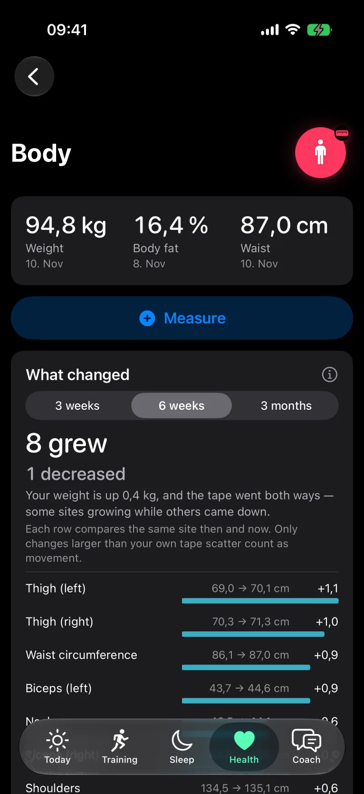
</td>
<td width="64%" valign="middle">

**Body** keeps your weight, body fat and tape measurements in one place. "What changed" compares the
same site then and now over three weeks, six weeks or three months, and only counts a change that is
larger than your own tape scatter, so it does not celebrate noise. Each body part has its own history
and a short guide on how to measure it the same way every time. Progress photos stay on your phone.

**Energy** answers "how much do I burn in a day?" in three independent ways: a formula based on your
height, weight and age, what your strap measured, and what your food log and scale imply. They never
agree perfectly, and the app shows you the gap instead of hiding it.

**Food** (on the phone) is a planner, not a diary you have to feed. Scan a barcode, pick from a food
database, read a label with the camera or just write down what you ate. The day's plan knows whether
you train or rest, and a diet plan can work towards a target weight at a pace you choose. Daily totals
from another nutrition app can come in through Apple Health instead.

**Fitness Age** compares your cardio fitness with typical people of different ages, and **Vitality**
turns your habits into a score from 0 to 100. Two more ages sit in Settings › Lab: **AgeLess** compares
your habits and **Daily rhythm** your day's movement with large studies. All of them are estimates for
motivation, not medical measurements, and the app says so next to the number.

</td>
</tr>
</table>

### Goals that bend with real life

Set goals on four levels:

| Level | Examples |
|---|---|
| **Daily** | 10,000 steps, 7 hours of sleep, a workout, or a box to tick like "stretched for ten minutes" |
| **Weekly** | 4 workouts, 150 minutes in zone 2, 5 nights of 7 hours, 100 working sets |
| **Monthly** | 100 km of running, 20 workouts, 25 days with enough steps |
| **Long-term** | Reach a target weight by summer, collect 1.8 million steps, keep two rest days a week |

What makes them different:

- **A fair pace.** Your weekly target is spread over the days you actually plan to train, with your
  rest days left out. A marker shows where you should be by today, so on Wednesday "2 of 5" can be
  perfectly on track.
- **Clear states in words, not just colours:** Reached, Ahead, On track, Close, Behind, Out of reach,
  Protected.
- **Life happens.** A week where you reached 80% counts as "almost" and does not break your streak.
  Pause a goal or get ill, and your streak is protected.
- **Most goals tick themselves.** Steps, sleep and workouts are measured automatically. For things the
  app cannot see, it asks you the next day: "Done yesterday?"
- **Suggestions from your own weeks.** When you set up a goal, the app offers an easy, a recommended
  and an ambitious level, based on what you actually did recently.
- **Records and badges** are real facts from your data, like your best week, never random rewards.

Goals also appear as a widget on the Home Screen, on the Lock Screen, on the Apple Watch and through
Siri ("How am I doing on my goals?"). Android has the goals, their badges and streaks, their
notifications and its own home-screen widget.

### Breathe, intervals and the lab book

**Breathe** guides slow breathing with a gentle buzz on your wrist: one pulse to breathe in, two to
breathe out. You can close your eyes. At the same time the strap measures how your HRV responds. Many
patterns are included, from calm 4-6 breathing to box breathing.

**Intervals** is a silent workout timer. The strap buzzes at every change between work and rest, so you
never have to look at a screen.

**Health records** keep blood tests, blood pressure and other measurements beside everything else, so a
lab result and a bad week can finally sit on the same page.

### ECG on the WHOOP MG

The WHOOP MG has electrodes for an ECG. NOOP Forge can take a **30-second reading**: hold your finger
on the strap and watch the trace appear. Afterwards it shows your heart rate, how regular the rhythm
was and the standard intervals of the heartbeat, drawn at the same scale as a paper ECG. You can put a
reading next to an Apple Watch ECG to compare. Readings are saved on your phone.

Recording is an Apple feature for now. Android shows the readings you already have; recording there is
still to come.

This is **not a medical device** and gives no diagnosis. If you are worried about your heart, see a
doctor.

### An AI coach that knows your data (optional)

Ask questions about your own body in normal language. "Why is my Charge low today?" "Did I really train
in zone 2 this week?" "Is coffee hurting my sleep?" The coach looks up your real numbers and answers
from them.

**Every morning a short brief** sums up your night and your readiness, suggests one session for the day
and names the one thing that would help most. If something looks off, for example a wake time that
seems too early, it says so first instead of planning your day on a wrong number. The suggested session
appears on Today with **Accept**, **Change** and **Not this one**. The effort it is worth is calculated
by the app from your own heart rate zones, not invented by the AI.

- **Off until you turn it on.** It is the only part of the app that uses the internet.
- **It tells you what it is before you start:** it is only as good as its model, it is a second opinion
  and not a doctor, and it says exactly what gets sent and when.
- **You choose the AI.** Use your own key for Anthropic, OpenAI, Google Gemini or OpenRouter, or run a
  model on your own computer so nothing leaves your home.
- **You choose what it may read**, topic by topic: sleep, workouts, stress, your journal and so on.
- **It suggests, you decide.** It can propose a workout or a goal, but nothing is saved until you
  accept it.
- **It remembers** what you told it ("my knee hurts when I run"), and you can see, edit and delete
  every memory.
- **Make it your coach.** Give it a name and a photo, choose a calm, friendly or direct style and how
  long its answers should be.

### Devices, settings and the rest

- **Devices:** besides WHOOP straps, any standard heart-rate chest strap (Polar, Wahoo, Garmin and
  others) works for live heart rate. Oura rings are supported experimentally.
- **Make it yours:** ten languages, light or dark, colour profiles (colourful by default, or the calmer
  Stone, Slate and Sage), the picture behind Today, the app icon, and which optional features you want.
- **Backups:** one file holds everything. Save it to a folder of your choice (for example iCloud Drive)
  automatically every day, and restore it on a new phone, on either platform.

| Also included | What it does |
|---|---|
| **Widgets** | Your scores, heart rate, stress, energy and goals on the Home Screen and Lock Screen, and on the Android home screen |
| **Apple Watch** | A companion app with complications, live heart rate, breathing and workouts |
| **Siri and Shortcuts** | "How am I doing on my goals?", sync the strap, ask the coach, export a route |
| **Live Activities** | A running workout or a strap sync on the Lock Screen and in the Dynamic Island |
| **Illness early warning** | Optional. Tells you when several body signals change at the same time, as often happens before a cold. Not a diagnosis |
| **Strap automations** | Double-tap the strap to mark a moment, a buzz when your heart rate goes too high during a workout |
| **Imports** | WHOOP export, Apple Health, Health Connect, Strong, Hevy, FitNotes, Liftosaur, Oura, Fitbit, Garmin and Mi Fitness exports, GPX, TCX and FIT routes |
| **Cycle tracking** | Optional, on the phone: the cycle day on a dial of real days, what the phase tends to mean and the nightly temperature of this cycle |

---

## NOOP Forge on Android

<p align="center">
  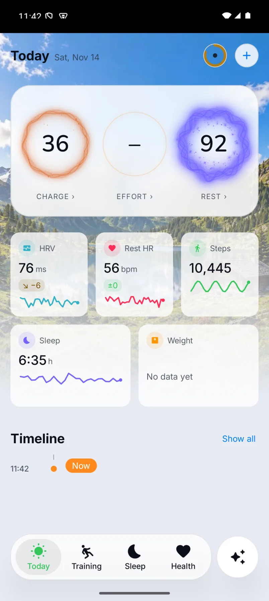
  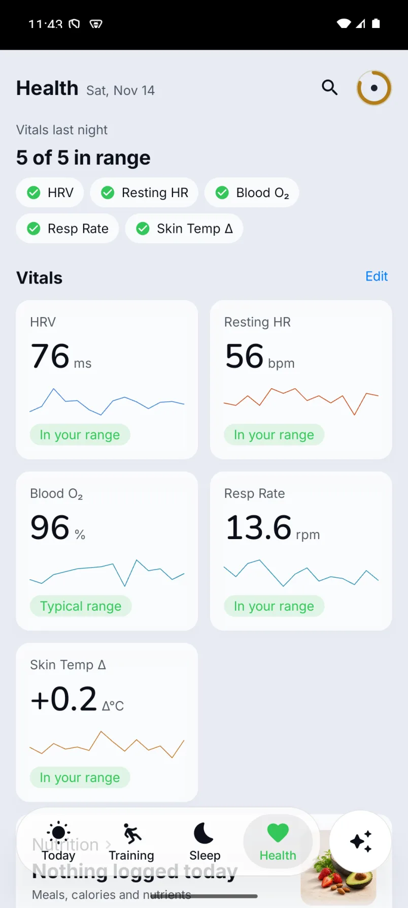
  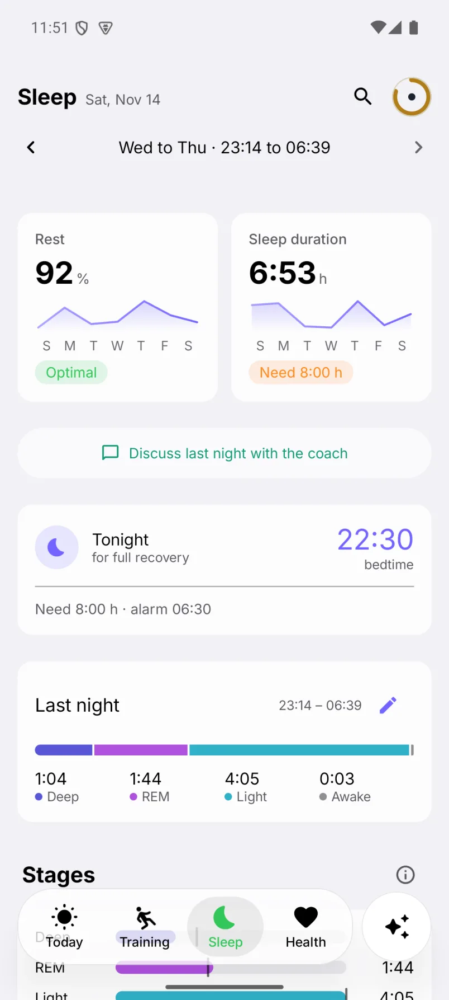
</p>
<p align="center">
  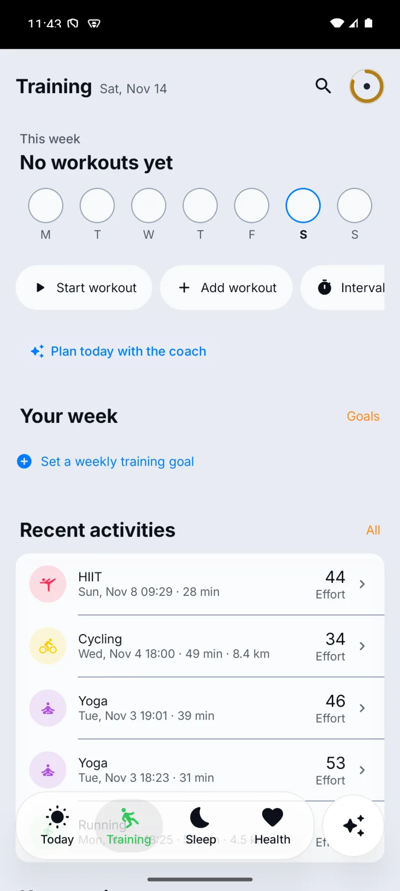
  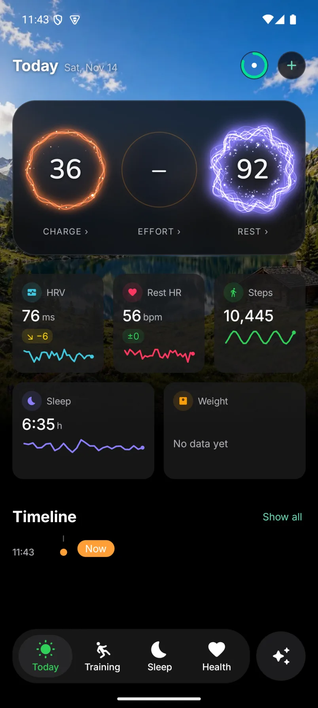
</p>

Android is not a smaller sibling here. It pairs with the strap, syncs the night, draws the same screens
and asks the **same Swift core** for every number, so an Android phone and an iPhone fed the same night
show the same Charge, the same Effort and the same Rest.

<table>
<tr>
<td width="62%" valign="top">

#### What is there

- **Strap:** pairing, the overnight sync, live heart rate, alarms and automations
- **Scores:** Charge, Effort and Rest with "what shaped your Charge", every Today layout, colour
  profile and picture, Trends, Stress, Mind, Breathe and Intervals
- **Sleep:** the night in detail, stages against your typical night, editing a night
- **Training:** routines, the live strength session with its rest timer and plate calculator, the
  exercise library, GPS workouts with voice feedback and auto-pause, strength, cardio, training load,
  training history and the muscle map
- **Your life around it:** goals with badges, streaks and notifications, Body, Energy with its plan,
  Fitness Age, AgeLess, daily rhythm, the food log and the diet plan
- **The coach:** chat, history and plan book
- **The rest:** a home-screen widget, imports from WHOOP, Apple Health exports, Health Connect, Mi
  Fitness, Oura, Fitbit and Garmin, and backups in the same `.noopbak` file

</td>
<td width="38%" valign="top">

#### What is still open

- Recording an ECG
- Elevation while recording a route
- The coach's on-device model
- The strap's buzz for heart-rate zones
- A few provider features that need your own key

</td>
</tr>
</table>

> [!IMPORTANT]
> **Why it is still called a testing build.** Everything above has been built and checked on an
> emulator, and about sixty-five of the Android screens' calculations are compared against the iPhone's
> on every test run. What no emulator can prove is Bluetooth: pairing, live heart rate, a full overnight
> sync and reconnecting on real phones. Until testers have confirmed those with strap logs, the Android
> build stays labelled testing.

**Want to help?** Install the APK from the
[testing release](https://github.com/DX23876/noop/releases/tag/testing-latest), run it beside your
usual app for a few days and report what you see:
[Android testing](docs/fork/android/TESTING.md) says what to look at and what a useful report contains.
Running state and open steps: [Android status](docs/fork/android/STATUS.md).

**Want a finished Android app today?** Use [ryanbr/noop](https://github.com/ryanbr/noop), the original
project, whose Android app is shipped and settled.

---

## Where each feature runs

| | iPhone / iPad | Mac | Apple Watch | Android |
|---|:---:|:---:|:---:|:---:|
| Pair a strap, sync its history | ✅ | ✅ | – | ✅ |
| Charge, Effort, Rest and their breakdown | ✅ | ✅ | Complications | ✅ |
| Sleep, the night in detail, sleep debt | ✅ | ✅ | – | ✅ |
| Trends, Stress, Mind, Journal, what works | ✅ | ✅ | – | ✅ |
| Workout log, routines, live strength session | ✅ | ✅ | Start and heart rate | ✅ |
| GPS activities with voice feedback | ✅ | – | – | ✅ (no elevation yet) |
| Muscle map, strength, cardio, training load | ✅ | ✅ | – | ✅ |
| Goals, badges, streaks, records | ✅ | ✅ | ✅ | ✅ |
| Body, Energy, Fitness Age, AgeLess, daily rhythm | ✅ | ✅ | – | ✅ |
| Food log and diet plan | ✅ | – | – | ✅ |
| Breathe and Intervals | ✅ | ✅ | ✅ | ✅ |
| ECG on a WHOOP MG | ✅ | ✅ | – | Readings only |
| AI coach | ✅ | ✅ | – | ✅ (no on-device model) |
| Widgets | Home and Lock Screen | – | Complications | Home screen |
| Live Activities, Dynamic Island | ✅ | – | – | – |
| Siri and Shortcuts | ✅ | ✅ | – | – |
| Apple Health | ✅ | ✅ | ✅ | Health Connect |
| Cycle tracking | ✅ | – | – | ✅ |
| Backup and restore (`.noopbak`) | ✅ | ✅ | – | ✅ |

---

## NOOP Forge or ryanbr/noop?

NOOP Forge is a **fork**: a copy of the open-source project [NOOP by ryanbr](https://github.com/ryanbr/noop)
that is developed further on its own. The connection to the strap, the scores and the basic design come
from NOOP. Forge regularly takes over NOOP's improvements and builds its own features on top.

Both are free, both keep your data on your device, and both need no WHOOP subscription.

### Which one is right for me?

| If you… | Choose |
|---|---|
| use an **Android** phone and want a finished app today | **ryanbr/noop.** Forge for Android is still in testing |
| use an **Android** phone and want to help test the shared core | **NOOP Forge**, see [Android](#noop-forge-on-android) |
| want the **original** project with its larger community | **ryanbr/noop** |
| want a **workout log, goals, body tracking and muscle analysis** in the same app | **NOOP Forge** |
| want an **AI coach** that can look up your real data and suggest plans | **NOOP Forge** |
| want to take **ECG readings** with a WHOOP MG | **NOOP Forge** |
| use **iPhone or Mac** and want the most features | **NOOP Forge** |

### Side by side

Status 14 November 2026: NOOP Forge 12.2.1 is the current release, 13.0.0 is in testing with builds for
iPhone, Mac and Android. Forge regularly merges ryanbr/noop; the 13.0.0 line contains its changes up to
early November 2026.

| | ryanbr/noop | NOOP Forge |
|---|---|---|
| **Platforms** | Android, iPhone, iPad, Mac, Apple Watch | iPhone, iPad, Mac, Apple Watch; Android in testing |
| **Who makes it** | The original project and its community | One anonymous developer, building on the original |
| **How the platforms relate** | Two implementations, Swift and Kotlin, kept byte-identical by rule | One shared Swift core, thin apps on top, Android included |
| **Charge, Effort, Rest, sleep, HRV, stress** | ✅ | ✅ Same foundation |
| **Today screen** | Rings or liquid vessels | Living rings over a picture, a dashboard of tiles you place yourself, and a timeline of the day |
| **Score explanations** | ✅ | ✅ Plus every factor with your own usual range and what it did to the score |
| **Workout logging** | A gym log book: sets, programs, double-tap the strap for the next set | The same, plus a full training hub: routines, weekly plan, 1,324 exercises, supersets, rest timer, plate calculator, progression hints |
| **Starting a workout** | Separate places | One start screen everywhere, Apple-style live view with spoken splits |
| **Muscle analysis** | Not available | Balance, fatigue and strength on a body map |
| **Training Load** | One card | Separate strength and cardio, years of history, "room today", duplicate check |
| **Goals** | A hydration goal | Daily, weekly, monthly and long-term goals with fair pace, streaks, badges, widget, Watch and Siri |
| **Body tracking** | Weight in the profile | Weight trend, body fat, tape measurements per body part, progress photos |
| **Food and energy** | Calorie estimates | A food log with barcode scanning, a diet plan, and an energy page comparing three independent estimates |
| **ECG (WHOOP MG)** | Experimental capture, no reading screen | Full 30-second readings with analysis and Apple Watch comparison |
| **AI coach** | Answers questions from a short summary of your data. Anthropic, OpenAI, Gemini or your own server | Looks up 38 kinds of data itself, suggests workouts and goals, remembers what you told it, permission per topic. Adds OpenRouter |
| **Hevy** | Import | Two-way sync: reads your workouts and sends routines you approved |
| **Imports** | WHOOP, Apple Health, Health Connect, Strong, Hevy, nutrition CSV | The same plus FitNotes, Liftosaur, Oura, Fitbit, Garmin, Mi Fitness, and lab reports from a photo or PDF |
| **Widgets** | Main, heart rate, stress, coach | The same plus score rings, energy and goals |
| **Languages** | 10 | The same 10 |
| **Install on iPhone** | AltStore, SideStore or direct IPA | The same, with its own source |
| **Release names** | `vX.Y.Z` | `vX.Y.Z-dx` (for example `v12.2.1-dx`), so the two never collide |

<details>
<summary><b>The technical differences in detail</b></summary>

| | ryanbr/noop | NOOP Forge |
|---|---|---|
| Code base | Swift for Apple, an independent Kotlin reimplementation for Android, kept byte-identical by rule | One shared Swift core for every platform. Android is a Kotlin shell (Bluetooth and its frame decoding, Android services, Compose screens) that calls the core through JNI and stores in the same SQLite database. The parity rule was retired on 23 July 2026; Android came back on the shared core on 25 October 2026, and Room left the app on 1 November 2026 |
| Swift packages | 8 | 13: adds `StrandCore` (the shared app core), `NoopCoreJNI` (the Android bridge), `StrandTraining`, `MuscleMap` and `SemanticMemory` |
| Coach | 2 source files plus 4 provider adapters | About 60 source files, 38 tools, nine permission purposes, an on-device embedding model for memory |
| Coach memory | Stored chat messages | Up to 120 facts with confirmation for health facts, expiry and ranking; on-device semantic search |
| Calorie model | Heart-rate formula | Version 9: walks priced by pace, other sessions by a VO₂max that fits the body, opt-in Apple Watch calibration |
| Benchmarks | Sleep staging, PSG | Adds energy and memory retrieval benches |
| CI | Android, parity, packages, app build, hygiene | Packages, app build, Android build with the shared core, release builds, attribution and translation gates, plus a local test gate before every push to `main` |

Shared by both: the Bluetooth decoders and safety checks, WHOOP 4.0 and 5.0/MG support, experimental
Oura and Polar paths, the storage layer, the core scoring, Breathe, Intervals, Stress, Mind, the lab
book, alarms, backups and the design system. Backups from ryanbr/noop can be imported into Forge, on
both platforms.

</details>

---

## Privacy in plain words

Everything stays on your device: your strap data, scores, workouts, goals, journal and coach memories.
There is no NOOP server and no account. Nobody, including the developer, can see your data.

The app only goes online in these cases, and only if you allow it:

| What | When |
|---|---|
| **AI coach** | Only if you turn it on, only to the AI provider you picked, never raw heart data |
| **Update check** | When you tap it, or at most once a day if you allow it |
| **Hevy sync** | Only if you connect your Hevy account |
| **Food database** | Only when you look up a barcode or download a food pack |
| **Exercise media** | Only when you tap download in the training settings. The pack comes straight from its source; no workout or health data is sent |
| **Oura cloud import** | Only in a build you compile yourself with your own Oura developer key. Pairing a ring over Bluetooth needs no internet |

- No ads, no tracking, no analytics, no crash reports sent anywhere.
- NOOP contains no WHOOP software. It talks to the strap you own, the same way a heart-rate app talks to
  a chest strap.
- Your backup is a single file that you control.

More detail: [Privacy and security](docs/PRIVACY_SECURITY.md) and [Scope](docs/SCOPE.md).

---

## Install

NOOP Forge is not in the App Store or on Google Play. That is deliberate: it keeps the project
independent and anonymous. You install it yourself, and on the iPhone a free helper app signs it with
your own Apple ID.

<table>
<tr>
<td width="50%" valign="top">

### 📱 iPhone and iPad

1. Install **[AltStore](https://altstore.io)** or **[SideStore](https://sidestore.io)** (follow their
   guide, it takes a few minutes).
2. Add this source:
   ```
   https://raw.githubusercontent.com/DX23876/noop/main/altstore-source.json
   ```
   - **AltStore:** Browse → **+** → paste the link.
   - **SideStore:** Sources → **+ Add Source** → paste the link.
3. Install **NOOP Forge** from that source and open it.

With a free Apple ID the app has to be refreshed every seven days. AltStore and SideStore do that for
you in the background.

You can also download the file directly from the
[release page](https://github.com/DX23876/noop/releases/tag/v12.2.1-dx):
`NOOP-ios-unsigned-v12.2.1-dx.ipa` includes the widgets, and
`NOOP-ios-full-unsigned-v12.2.1-dx.ipa` also contains the Apple Watch app.

**Feather or a bought certificate?** The app runs, Apple Health included. The widgets usually stay
empty ("No shared data"): they read the app's data through an App Group, and Apple allows App Groups
only on profiles with a fixed App ID. Bought certificates mostly come with a wildcard profile, which
Feather uses for every part of the app. For widgets, use AltStore or SideStore: they sign with your own
Apple ID and create the App Group for you. If you have profiles with
fixed App IDs that share one App Group, the [Forge Signer](https://dx23876.github.io/forge/sign/) signs
every part with its own profile and links the App Group for you.

More in the [iOS guide](docs/IOS.md).

</td>
<td width="50%" valign="top">

### 💻 Mac

1. Download `NOOP-macos-v12.2.1-dx.zip` from the
   [release page](https://github.com/DX23876/noop/releases/tag/v12.2.1-dx).
2. Unzip it and move **NOOP** to your Applications folder.
3. The first time, **right-click → Open** (a normal double-click is blocked because the app is not
   from the App Store).
4. Allow Bluetooth when asked.

Works on Apple Silicon and Intel Macs.

</td>
</tr>
<tr>
<td width="50%" valign="top">

### 🤖 Android

1. Download `NOOP-Forge-android-13.0.0-testing.apk` from the
   [testing release](https://github.com/DX23876/noop/releases/tag/testing-latest).
2. Open it on the phone and allow installing from this source.
3. Accept the terms and go through the setup; it pairs your strap on the way.

Android 8 or later. This is a **testing build**: see
[NOOP Forge on Android](#noop-forge-on-android) for what that means and
[Android testing](docs/fork/android/TESTING.md) for what to check.

</td>
<td width="50%" valign="top">

### ⌚ Apple Watch and 🧪 the testing build

The watch app comes inside the `full` IPA. It needs four profiles with fixed App IDs that share one App
Group (iPhone app, widgets, Watch app, Watch complication), for example from your own Apple developer
account. Sign it with the [Forge Signer](https://dx23876.github.io/forge/sign/), and the watch app
appears in the Watch app on your iPhone. AltStore and SideStore leave the watch app out.

Want the redesigned 13.0 early? The
[testing release](https://github.com/DX23876/noop/releases/tag/testing-latest) has builds for iPhone,
Mac and Android. It installs over Forge and keeps your data. Make a backup first; the
[testing guide](docs/fork/TESTING-13.0.0.md) says what to look at.

</td>
</tr>
</table>

<details>
<summary><b>🛠️ Build it yourself</b></summary>

**Apple:** Xcode 26 or later and [XcodeGen](https://github.com/yonaskolb/XcodeGen).

```bash
git clone https://github.com/DX23876/noop.git
cd noop && xcodegen generate
open Strand.xcodeproj
```

Choose **NOOPiOS** for iPhone or **Strand** for Mac.

**Android:** JDK 17, the Android SDK, a Swift 6.4.1 toolchain with the Swift SDK for Android and NDK
r30. The Gradle build compiles the shared Swift core first
(`android/swift-core/build-swift-core.sh`), then the app:

```bash
cd android && ./gradlew assembleFullDebug
```

See the [build guide](docs/BUILD.md) and [Android](docs/ANDROID.md).

</details>

**Check what you downloaded.** Release files are built by GitHub Actions from this repository's public
code. From the first release after 13.0.0, each release also carries a `.sha256` file with every
download's checksum, and GitHub signs where each file was built. With the
[GitHub CLI](https://cli.github.com) you can check that a file came from this repository's own release
workflow:

```bash
gh attestation verify NOOP-ios-unsigned-v13.0.0-dx.ipa --repo DX23876/noop
```

**Updating keeps your data.** **Moving to a new phone, or between platforms:** export a backup under
Data & Backup and import it on the new device. Backups from ryanbr/noop can be imported too.

---

## For the technically curious

Want to know exactly how a number is calculated or how the app talks to the strap? It is all written
down:

| Topic | Read |
|---|---|
| How Charge, Effort, Rest, sleep and HRV are calculated, with sources | [Analytics](docs/ANALYTICS.md) · [FAQ](docs/FAQ.md) |
| Every feature in detail | [Feature guide](docs/FEATURES.md) |
| One core, several platforms | [Cross-platform](docs/CROSS_PLATFORM.md) · [Android](docs/ANDROID.md) |
| The AI coach: all 38 tools, permissions, memory, safety rules | [Coach guide](docs/fork/COACH.md) |
| Balance, fatigue and strength on the muscle map | [Muscle analytics](docs/fork/MUSCLE_ANALYTICS.md) |
| Fitness Age and the study behind it | [Fitness Age](docs/FITNESS_AGE.md) |
| How the app talks to the strap | [Protocol](docs/PROTOCOL.md) · [Device roadmap](docs/DEVICE_SUPPORT_ROADMAP.md) |
| How the code is organised | [Architecture](docs/ARCHITECTURE.md) · [Data model](docs/DATA_MODEL.md) · [Packages](docs/LIBRARY.md) |
| Privacy and security | [Privacy and security](docs/PRIVACY_SECURITY.md) |
| Building, signing, contributing | [Build](docs/BUILD.md) · [Fork guide](docs/FORK_GUIDE.md) · [Contributing](docs/CONTRIBUTING.md) |
| Everything else | [Documentation map](docs/README.md) |

<details>
<summary><b>How the code is built</b></summary>

All logic lives in Swift packages that run without the app, without a strap and without Bluetooth, so
they can be tested on their own. The apps for iPhone, Mac and Watch are thin layers on top, and so is
the Android app: its Kotlin code handles Bluetooth, Android services and the screens, and asks the same
Swift core for every number.

```
 Apps        iPhone · iPad · Mac · widgets · Apple Watch     Android (Kotlin, Compose)
 Coach       chat, AI providers, tools, goals, permissions
 ─────────────────────────────────────────────────────────────
 Bridge      NoopCoreJNI           the shared core for Android
 Core        StrandCore            daily analysis, rebuilds, backups, energy, food, sync
 Design      StrandDesign          colours, components, charts (Apple only)
 Training    StrandTraining        routines, exercises, set maths
             MuscleMap             muscles and body maps
 Memory      SemanticMemory        on-device search for the coach
 Import      StrandImport          WHOOP, Apple Health, Strong, Hevy, Oura, Garmin…
 Analytics   StrandAnalytics       HRV, recovery, strain, sleep, load
 Storage     WhoopStore            SQLite database and migrations
 Protocol    WhoopProtocol         reading the strap's Bluetooth data
             OuraProtocol · PolarProtocol
```

- The app never sends commands that could change or erase anything on the strap, and checks every
  message from it for transmission errors.
- When a scoring formula changes, old days are recalculated in a controlled step, never silently. In
  13.0 that step scores the whole history once, resumes where it stopped and never touches raw data or
  anything you entered.
- A new way of reading a body signal is only trusted after it follows real changes across many nights.
  Until then it stays an experiment you have to switch on.
- About sixty-five of the Android screens' calculations are compared against the iPhone's on every test
  run, so the two platforms cannot quietly drift apart.

</details>

---

## Ideas, votes and taking part

NOOP Forge is built by one person in spare time, so what gets built next is a real question. Say what
you want, and say which of the ideas already there matter to you.

<table>
<tr>
<td width="33%" valign="top">

### 💡 Suggest something

[**Ideas** in Discussions](https://github.com/DX23876/noop/discussions/categories/ideas) is the place.
One idea per thread, with what you are trying to do and why the app makes it hard today. A thread is
better than an issue here: ideas get discussed and reshaped, bugs get fixed.

</td>
<td width="33%" valign="top">

### 👍 Vote for one

Every idea carries an **upvote arrow** on the left. Press it on the ones you want. Sort the list by
**Top** to see what people actually asked for, which is the first thing checked when a release is
planned. **[Polls](https://github.com/DX23876/noop/discussions/categories/polls)** is for the bigger
either/or questions, where a straight vote decides.

</td>
<td width="33%" valign="top">

### 🐞 Report a bug

A confirmed fault goes to an [issue](https://github.com/DX23876/noop/issues/new/choose) with a strap
log, because the app runs only on your device and without a log a real fault cannot be told from a
setup detail. Not sure whether it is a bug? Ask first, on
[Discord](https://discord.com/invite/wKgyqVdjrP) or in
[Q&A](https://github.com/DX23876/noop/discussions/categories/q-a).

</td>
</tr>
</table>

### Want to write code? Yes, please, but talk first

Help is welcome, and a pull request that nobody saw coming usually cannot be taken, however well it is
written. **Open an idea or an issue first and wait for a yes.** Three reasons, all of them real:

- **The scope is hard, not a preference.** No server, no account, no cloud, no telemetry, and no WHOOP
  firmware or app code in this repository. A change that crosses those lines is refused whatever it
  does, and finding that out after a weekend of work is nobody's idea of fun.
- **Some of this is already half-built.** The Android screens, the redesign and the food plan all have
  work in flight that is not on `main` yet. A sentence beforehand saves you from building the same
  thing twice.
- **Some areas have rules of their own.** A new Bluetooth command is issue-first and has to be
  reversible. Analytics changes carry a recalculation of everyone's history. Both are in
  [`docs/CONTRIBUTING.md`](docs/CONTRIBUTING.md), which is worth the ten minutes before you start.

After the yes: one concern per pull request, English for everything repository-facing, tests that run
without a strap, and say what you verified on hardware. Design work, translations, a good bug report
with a strap log and a tested Android build on a phone nobody has tried yet all count as taking part,
and the release notes credit people by their GitHub handle.

### Where people talk

**💬 [The Noop Community Discord](https://discord.com/invite/wKgyqVdjrP)** is the quickest place for a
question, for setup help and for "is this normal?". It is the shared NOOP community, not a fork-only
room, so say which app you are running when you ask. A confirmed fault still wants an issue with a
strap log: a question answered on Discord helps you, an issue is what gets tracked until it is fixed.

Also: [Discussions](https://github.com/DX23876/noop/discussions) for ideas and votes ·
[r/NoopBand](https://www.reddit.com/r/NoopBand/) for tips and release news ·
[the wiki](https://github.com/DX23876/noop/wiki) for troubleshooting and the WHOOP 5.0 and MG status

---

## About the project

NOOP Forge is an independent, non-commercial fork of [ryanbr/noop](https://github.com/ryanbr/noop) and
not the official NOOP app. It was called NOOP AI until October 2026. The original project deserves the
credit for the strap connection, the scores and the design. NOOP Forge is not affiliated with WHOOP.

The Bluetooth work builds on community research, with thanks to
[`johnmiddleton12/my-whoop`](https://github.com/johnmiddleton12/my-whoop) (WHOOP 4.0),
[`b-nnett/goose`](https://github.com/b-nnett/goose) (WHOOP 5.0/MG) and
[`groue/GRDB.swift`](https://github.com/groue/GRDB.swift) (database).

> [!IMPORTANT]
> NOOP Forge is not a medical device. Its scores, ECG readings and health values are estimates for
> personal use, not medical advice or a diagnosis. If you have health concerns, talk to a doctor.

## Help and support

A question is quickest answered on the
**[Noop Community Discord](https://discord.com/invite/wKgyqVdjrP)**. Every channel, and what belongs
where, is in [SUPPORT.md](SUPPORT.md) and the [FAQ](docs/FAQ.md#help-bug-reports-and-support); what to
do with an idea is in [Ideas, votes and taking part](#ideas-votes-and-taking-part).

## Support NOOP Forge

NOOP Forge is free. If it saves you a subscription or simply makes your strap more useful, you can buy
me a coffee on [Ko-fi](https://ko-fi.com/dx23876). It goes into the time and tools behind new features,
the next releases and the Android app.

Donating is optional. The app works exactly the same either way and never nags you about it.

<a href="https://ko-fi.com/dx23876"></a>

## License

Source-available under the [PolyForm Noncommercial License 1.0.0](LICENSE): free for personal,
non-commercial use. See [NOTICE](NOTICE) and [ATTRIBUTION.md](ATTRIBUTION.md) for credits.

**Building on NOOP Forge?** You are welcome to, within the license. It carries two Required Notices,
one for NOOP and one for NOOP Forge:

```
Required Notice: Copyright 2026 NoopApp
Required Notice: Copyright 2026 DX23876 (NOOP Forge) – https://github.com/DX23876/noop
```

Anyone who passes on any part of this code, changed or not, has to include both lines with the
license terms. Please also name the projects you build on in your README.
