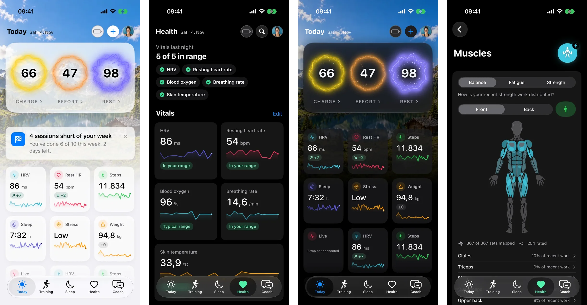

<p align="center">
  
</p>

<h1 align="center">NOOP Forge</h1>

<p align="center">
  <b>Your strap. Your numbers. No subscription.</b><br>
  A complete recovery, sleep and training app for WHOOP 4.0, 5.0 and MG straps.<br>
  One shared core for iPhone, iPad, Mac, Apple Watch and Android. No account, no cloud.
</p>

<p align="center">
  <a href="https://dx23876.github.io/forge/"><b>Website</b></a> ·
  <a href="https://dx23876.github.io/forge/install/"><b>Install</b></a> ·
  <a href="https://dx23876.github.io/forge/features/"><b>Features</b></a> ·
  <a href="https://dx23876.github.io/forge/compare/"><b>Compare</b></a> ·
  <a href="https://dx23876.github.io/forge/firmware/"><b>Firmware</b></a> ·
  <a href="docs/README.md"><b>Docs</b></a>
</p>

<p align="center">
  <a href="https://github.com/DX23876/noop/releases/tag/v12.2.1-dx"></a>
  <a href="https://github.com/DX23876/noop/releases/tag/testing-latest"></a>
  
  <a href="LICENSE"></a>
  <a href="https://discord.com/invite/wKgyqVdjrP"></a>
</p>

<p align="center">
  
</p>
<p align="center"><sub>The 13.0 testing build in demo mode, with made up numbers.</sub></p>

> [!WARNING]
> **Keep your strap away from the official WHOOP app.** It installs firmware updates by itself. On WHOOP
> 5.0 and MG, firmware **50.43.1.0** and **50.43.2.0** are reported to hold back data from independent
> apps, and there is no way back. Never connect the strap to the WHOOP app again and uninstall it.
> [What has been reported and how to check your strap](https://dx23876.github.io/forge/firmware/).

## What it is

NOOP Forge reads your WHOOP strap over Bluetooth and works everything out on your own device: how well
you recovered, how hard your day was, how you slept and how your training is going. Your data never has
to leave your phone and there is nothing to subscribe to.

- **Charge, Effort and Rest** every morning, each with its factors, your own range and what it did to
  the score.
- **Sleep** in stages against your typical night, sleep debt, a bedtime for full recovery, silent strap
  alarms.
- **Training:** a full gym log, GPS runs with spoken splits, a muscle map for balance, fatigue and
  strength, training load split into strength and cardio.
- **Goals** from daily to long term with a fair pace, streaks that survive a bad week, widgets, Watch
  and Siri.
- **Body, energy and food:** weight trend, tape measurements, a barcode food log, a diet plan and three
  independent estimates of what you burn.
- **ECG on the WHOOP MG:** 30 second readings with analysis.
- **An optional AI coach** on your own key or your own server that looks up your real data.

Every feature, with pictures: [dx23876.github.io/forge/features](https://dx23876.github.io/forge/features/).

## Why Forge

There are four free apps for a WHOOP strap: [ryanbr/noop](https://github.com/ryanbr/noop), Aura,
OpenStrap Edge and NOOP Forge. Forge is the one to pick if you want:

- **every Apple device and Android on one core**, so each device shows the same numbers;
- **the deepest training tools**, from the gym notebook to the muscle map;
- **every number explained**, with formula changes applied to your whole history in one controlled step;
- **open and checkable releases**, built by GitHub from this public code and signed where they were built;
- **NOOP's improvements too**, because Forge merges the original project regularly.

The others are ahead in places, and the comparison says where:
[four apps side by side](https://dx23876.github.io/forge/compare/).

## Install

| Device | How |
|---|---|
| **iPhone and iPad** (iOS 17+) | Add `https://raw.githubusercontent.com/DX23876/noop/main/altstore-source.json` in [AltStore](https://altstore.io) or [SideStore](https://sidestore.io), then install NOOP Forge |
| **Mac** (macOS 13+) | Download the zip from the [release page](https://github.com/DX23876/noop/releases/tag/v12.2.1-dx), move NOOP to Applications, right click and Open |
| **Apple Watch** | The `full` IPA from the release page, signed with the [Forge Signer](https://dx23876.github.io/forge/sign/) |
| **Android** (8+) | The APK from the [testing release](https://github.com/DX23876/noop/releases/tag/testing-latest). Testing until Bluetooth is confirmed on real phones |

Step by step, Feather and Apple Health, checking a download and moving from another app:
[install guide](https://dx23876.github.io/forge/install/). Backups from ryanbr/noop open in Forge.

## Privacy

Everything stays on your device. There is no NOOP server and no account, and nobody, the developer
included, can see your data. The app only goes online when you turn something on: the AI coach, an
update check, Hevy sync, a food lookup or an exercise media download. No ads, no tracking, no analytics.
Details: [Privacy and security](docs/PRIVACY_SECURITY.md).

## For the technically curious

| Topic | Read |
|---|---|
| How every score is calculated, with sources | [Analytics](docs/ANALYTICS.md) · [FAQ](docs/FAQ.md) |
| Every feature in detail | [Feature guide](docs/FEATURES.md) |
| One core, several platforms | [Cross-platform](docs/CROSS_PLATFORM.md) · [Android](docs/ANDROID.md) · [Android status](docs/fork/android/STATUS.md) |
| The AI coach | [Coach guide](docs/fork/COACH.md) |
| How the app talks to the strap | [Protocol](docs/PROTOCOL.md) |
| Code, building, contributing | [Architecture](docs/ARCHITECTURE.md) · [Build](docs/BUILD.md) · [Fork guide](docs/FORK_GUIDE.md) · [Contributing](docs/CONTRIBUTING.md) |
| Everything else | [Documentation map](docs/README.md) |

<details>
<summary><b>How the code is built</b></summary>

All logic lives in Swift packages that run without the app, without a strap and without Bluetooth. The
apps for iPhone, Mac and Watch are thin layers on top, and so is Android: its Kotlin code handles
Bluetooth, Android services and the screens and asks the same Swift core for every number.

```
 Apps        iPhone · iPad · Mac · widgets · Apple Watch     Android (Kotlin, Compose)
 Coach       chat, AI providers, tools, goals, permissions
 ─────────────────────────────────────────────────────────────
 Bridge      NoopCoreJNI           the shared core for Android
 Core        StrandCore            daily analysis, rebuilds, backups, energy, food, sync
 Design      StrandDesign          colours, components, charts (Apple only)
 Training    StrandTraining        routines, exercises, set maths
             MuscleMap             muscles and body maps
 Memory      SemanticMemory        on-device search for the coach
 Import      StrandImport          WHOOP, Apple Health, Strong, Hevy, Oura, Garmin…
 Analytics   StrandAnalytics       HRV, recovery, strain, sleep, load
 Storage     WhoopStore            SQLite database and migrations
 Protocol    WhoopProtocol         reading the strap's Bluetooth data
             OuraProtocol · PolarProtocol
```

The app never sends commands that could change or erase anything on the strap, and checks every message
from it for transmission errors.

</details>

## Taking part

- **Ideas and votes:** [Discussions](https://github.com/DX23876/noop/discussions/categories/ideas), one
  idea per thread; press the upvote arrow on the ones you want.
- **Bugs:** an [issue](https://github.com/DX23876/noop/issues/new/choose) with a strap log.
- **Questions and setup help:** the [Noop Community Discord](https://discord.com/invite/wKgyqVdjrP), the
  shared NOOP community, so say which app you run.
- **Code:** welcome, but open an idea or an issue first and wait for a yes. The scope rules are in
  [CONTRIBUTING](docs/CONTRIBUTING.md).

## About the project

NOOP Forge is an independent, non-commercial fork of [ryanbr/noop](https://github.com/ryanbr/noop) and
not the official NOOP app. The original project deserves the credit for the strap connection, the scores
and the design. NOOP Forge is not affiliated with WHOOP.

The Bluetooth work builds on community research, with thanks to
[`johnmiddleton12/my-whoop`](https://github.com/johnmiddleton12/my-whoop) (WHOOP 4.0),
[`b-nnett/goose`](https://github.com/b-nnett/goose) (WHOOP 5.0/MG),
[OpenStrap](https://github.com/OpenStrap) (MG ECG) and
[`groue/GRDB.swift`](https://github.com/groue/GRDB.swift) (database).

> [!IMPORTANT]
> NOOP Forge is not a medical device. Its scores, ECG readings and health values are estimates for
> personal use, not medical advice or a diagnosis. If you have health concerns, talk to a doctor.

NOOP Forge is free. If it saves you a subscription, you can
[buy me a coffee on Ko-fi](https://ko-fi.com/dx23876). The app works exactly the same either way.

## License

Source-available under the [PolyForm Noncommercial License 1.0.0](LICENSE): free for personal,
non-commercial use. See [NOTICE](NOTICE) and [ATTRIBUTION.md](ATTRIBUTION.md) for credits.

Building on NOOP Forge? You are welcome to, within the license. It carries two Required Notices:

```
Required Notice: Copyright 2026 NoopApp
Required Notice: Copyright 2026 DX23876 (NOOP Forge) – https://github.com/DX23876/noop
```

Anyone who passes on any part of this code, changed or not, has to include both lines with the license
terms.
